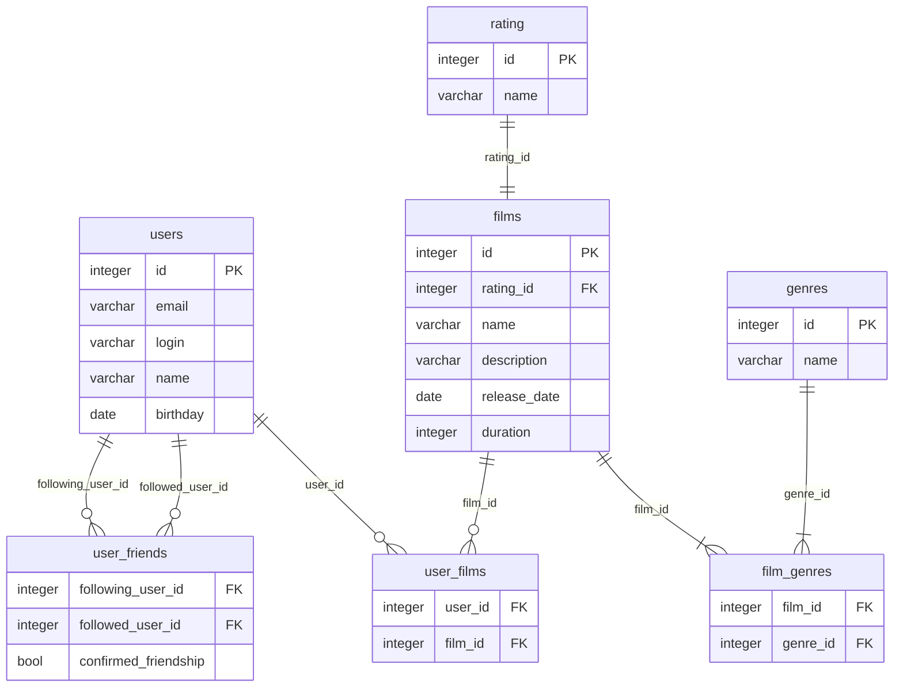

# java-filmorate


# Примеры запросов

```sql
-- Рейтинги фильмов
select f."name", r."name" from films f
join rating r on f.rating_id = r.id;

-- Фильмы понравившиеся пользователям
select u."name", f."name" from user_films uf
join users u on uf.user_id = u.id
join films f on uf.film_id = f.id;

-- Жанры фильмов
select f."name", g."name" from film_genres fg
join films f on fg.film_id = f.id
join genres g on fg.genre_id = g.id;

-- Подтвержденные друзья
select u1."name", u2."name" from user_friends uf
join users u1 on uf.following_user_id = u1.id
join users u2 on uf.followed_user_id = u2.id
where uf.confirmed_friendship = true;

-- Пользователи, которые отправили запрос на добавление в "Друзья"
select u1."name", u2."name" from user_friends uf
join users u1 on uf.following_user_id = u1.id
join users u2 on uf.followed_user_id = u2.id
where uf.confirmed_friendship = false;
```